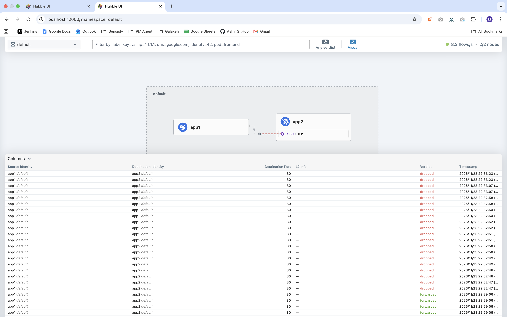
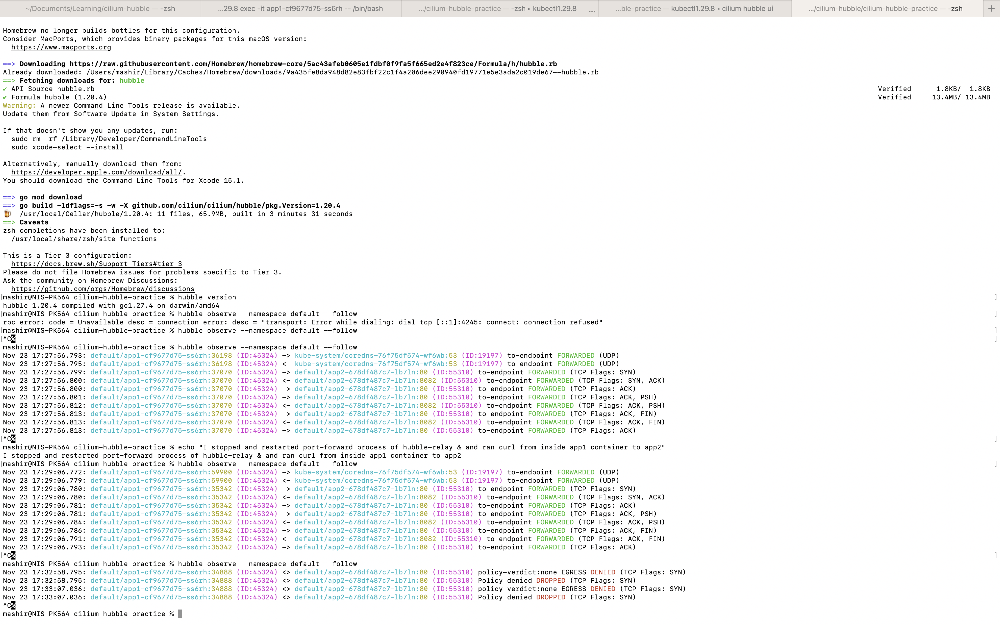

This repository is to practice Cilium Hubble for hand on poc 

For practice, I have completed the following lab: 
https://github.com/hacktivist123/cilium-playground/tree/main/demo/kubecon 

Observing traffic drop in Cilium UI after applying cilium network policy: 
 

Observing traffic drop in Cilium CLI after applying cilium network policy: 
 
